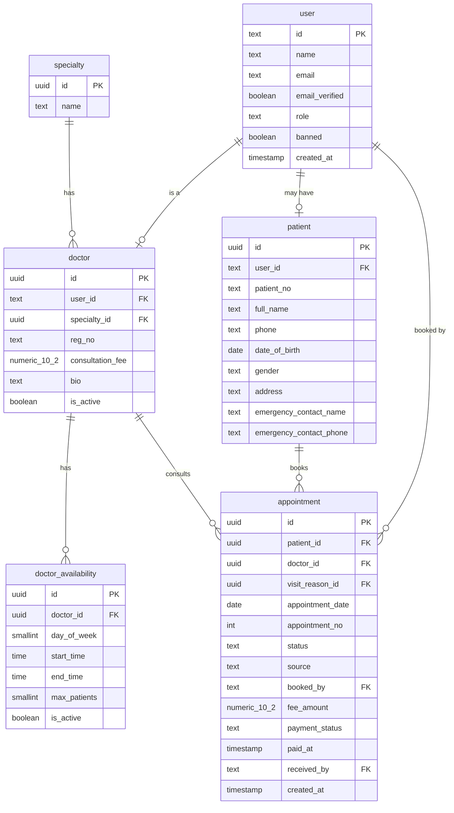
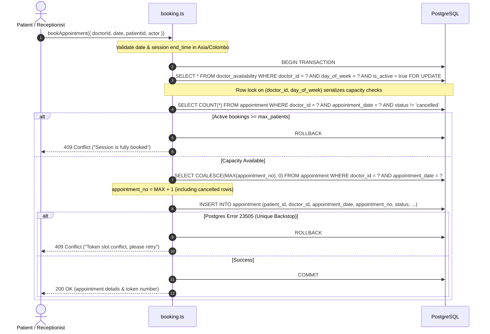
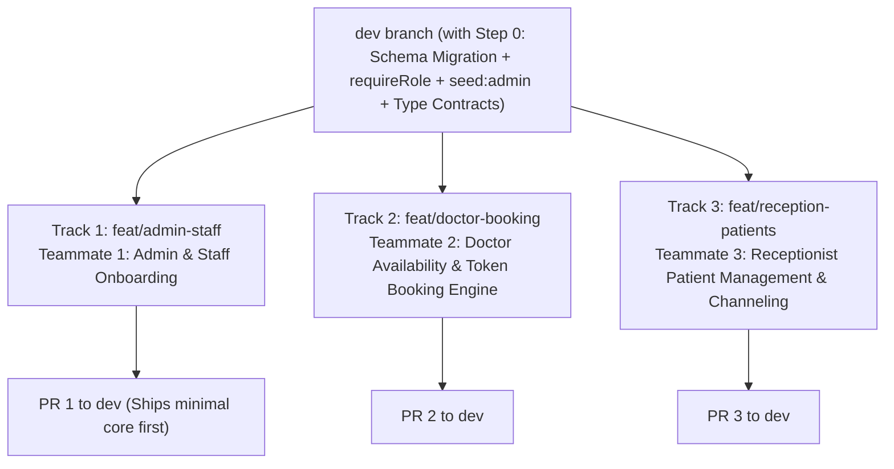

# Overdue Sprint Implementation Plan: ERD-Compliant Hospital Scheduling & Channeling

**Sprint Tasks**: SCRUM-187, SCRUM-130, SCRUM-160, SCRUM-162, SCRUM-175, SCRUM-169, SCRUM-163, SCRUM-138, SCRUM-132, SCRUM-133, SCRUM-135, SCRUM-139, SCRUM-190  
**Status**: Ready for Implementation (ERD-Canonical, Token-Based Channeling)

---

## 1. Architectural Source of Truth & ERD Alignment

Our existing database ERD is the absolute source of truth. No synthetic tables (such as `availability_slots`) are introduced. The scheduling engine follows the real-world hospital channeling model: **weekly recurring doctor schedules** (one session per weekday) paired with **monotonically increasing appointment token numbers** (`appointment_no`) bounded by a capacity limit (`max_patients`).



---

## 2. Exact Database Schema Changes

Only 4 existing tables from the ERD are updated, with no external tables created:

### 2.1 `patient` Table

- **Remove `nic` completely**: Enforces patient privacy (aligned with project non-collection policy). Removed from schema, validation, search, and UI forms.
- **Minimal Required Fields**: Only `full_name` is `NOT NULL`. All other demographic fields (`phone`, `date_of_birth`, `gender`, `address`, emergency contacts) are `NULLABLE`.
- **Linkage**: `user_id` remains nullable (permits walk-in registration with no portal account).
- **Indexes**: Add B-Tree indexes on `full_name`, `phone`, and `patient_no`. Phone is **NOT unique** (families frequently share a mobile number).

### 2.2 `appointment` Table

- **Required**: `patient_id` remains `NOT NULL`.
- **Nullable for this slice**: `visit_reason_id`, `fee_amount`, `payment_status`, `paid_at`, and `received_by` are nullable.
- **Channeling Columns**: `appointment_date` (`date`) and `appointment_no` (`integer`).
- **Audit & Source**: `booked_by` (`text` references `user.id`), `source` (`text`, e.g. `'online'` | `'reception'`), `status` (`text`, default `'booked'`).
- **Concurrency Backstop**: Unique constraint on `(doctor_id, appointment_date, appointment_no)`.

### 2.3 `doctor_availability` Table

- **Recurring Schedule**: `doctor_id` (FK to `doctor.id`), `day_of_week` (`smallint`, 0 = Sunday, 6 = Saturday), `start_time` (`time`), `end_time` (`time`), `max_patients` (`smallint`), `is_active` (`boolean`, default `true`).
- **Uniqueness Constraint**: Unique constraint on `(doctor_id, day_of_week)` enforcing exactly **one clinic session per doctor per weekday**.

### 2.4 `doctor` Table

- **Nullable Columns**: `reg_no`, `consultation_fee`, and `bio` are nullable (the admin staff creation form only collects name, email, role, and specialty).
- **Linkage**: `user_id` (`text` unique FK to `user.id`), `specialty_id` (`uuid` nullable FK to `specialty.id`), `is_active` (`boolean`, default `true`).

### 2.5 `specialty` Table

- Seed starter specialties in migration/seed (`Cardiology`, `General Medicine`, `Pediatrics`, `Dermatology`, `Orthopedics`) so admin dropdowns are populated immediately.

---

## 3. Core Booking Engine (`lib/services/booking.ts`)

Booking is token-based and strictly transactional to guarantee capacity limits under high concurrency.



### 3.1 Timezone & Validation Rules (Strict `Asia/Colombo`)

1. **Timezone Anchor**: "Today" and current time are strictly computed in `Asia/Colombo` (UTC+05:30), never the server's local UTC clock.
2. **Day of Week**: `day_of_week` (0 = Sunday ... 6 = Saturday) is derived from the ISO date string `YYYY-MM-DD` in `Asia/Colombo`.
3. **Date Validation**:
   - Past dates are rejected: `date < colomboToday` $\rightarrow$ `400 Bad Request` ("Cannot book an appointment in the past").
   - Today's session expiry: If `date === colomboToday` and `colomboCurrentTime > availability.end_time`, reject with `400 Bad Request` ("Today's clinic session has already ended").
4. **Doctor & Session Checks**:
   - If `doctor.is_active === false` $\rightarrow$ `400 Bad Request` ("Doctor is currently inactive").
   - If `doctor_availability.is_active === false` or no row matches `day_of_week` $\rightarrow$ `400 Bad Request` ("Doctor has no active clinic on this weekday").

### 3.2 Token Allocation & Cancellation

1. **Monotonic Numbers (Never Reused)**: `appointment_no` is computed as `MAX(appointment_no) + 1` across all existing rows (including cancelled). If Token #2 cancels, the next patient receives Token #3, preventing waiting-room display board confusion.
2. **Cancellation**: Setting `status = 'cancelled'` frees up session capacity (decrements active count), but the token number is never reassigned.
   - **Patient Cancellation**: Patients can cancel their own bookings via `POST /api/appointments/:id/cancel`.
   - **Receptionist Cancellation**: Receptionists can cancel appointments for walk-in patients or phone cancellations via the same endpoint.
3. **Patient "My Appointments"**: `GET /api/patient/appointments` returns active and past appointments for the authenticated patient's profile.
4. **Open-Date Listing (`GET /api/appointments/open-dates?doctorId=...`)**:
   - Evaluates the next 14 days in `Asia/Colombo`.
   - A date is open if:
     - An active `doctor_availability` row exists matching that day of week.
     - The date is in the future (or today before `end_time`).
     - The count of appointments with `status != 'cancelled'` is less than `max_patients`.
5. **Access Control**:
   - `patient`: Can only book for their own `patient.id` (derived from session).
   - `receptionist` / `admin`: Allowed on booking and open-dates endpoints; can book or cancel on behalf of any patient.

---

## 4. Patient Provisioning & Receptionist Channeling

### 4.1 Idempotent `getOrCreatePatientForUser(userId)` Helper

Instead of an asynchronous database hook on signup, patient profile association is handled lazily and idempotently:

```ts
export async function getOrCreatePatientForUser(userId: string): Promise<Patient> {
  const existing = await db.query.patient.findFirst({
    where: eq(patient.userId, userId),
  });
  if (existing) return existing;

  // Fetch user details for stub creation
  const userRecord = await db.query.user.findFirst({
    where: eq(user.id, userId),
  });

  const [created] = await db
    .insert(patient)
    .values({
      userId,
      fullName: userRecord?.name || "Patient",
      patientNo: sql`'PAT-' || LPAD(nextval('patient_no_seq')::text, 6, '0')`,
    })
    .returning();

  return created;
}
```

- **Invocation**: Called on first patient portal load (e.g. `/patient/layout.tsx`) and at the start of patient booking.
- **Role Safety**: In `lib/auth.ts`, `role` is server-controlled on signup (`input: false`, defaults to `'patient'`).

### 4.2 Walk-In Patients (Without Portal Accounts)

- Receptionist enters minimal details: only `full_name` is mandatory; phone, DOB, gender, and address are optional.
- **Duplicate Warning**: If `full_name` + `date_of_birth` + `phone` matches an existing patient, the UI displays a non-blocking warning asking the receptionist to verify before creating a new record.
- **Search**: Receptionists search by `patient_no`, `phone`, or `full_name`. Results display Name and Date of Birth to disambiguate common names.
- **Role-Gated Details (SCRUM-133)**: Viewing patient details exposes administrative data (phone, address) to receptionists, while masking clinical records.

### 4.3 Portal Account Creation for Walk-In Patients

- An existing walk-in patient (`user_id = null`) can be granted portal access by the receptionist:
  1. Receptionist clicks "Create portal account" and inputs patient's email (typed twice for validation).
  2. Server creates a `user` with role `'patient'` and random password, then updates `patient.user_id = user.id`.
  3. Dispatches set-password email with a 24h token.
- **Guaranteed No Duplicates**: Because `patient.user_id` is set directly on the existing record, when the patient later logs in, `getOrCreatePatientForUser` retrieves their existing profile and never creates a second patient row.

---

## 5. Zero-Knowledge Staff Provisioning & Better Auth Invite

- **Admin Never Knows Password**: Admin supplies Name, Email, Role (`doctor`, `receptionist`, `nurse`, `pharmacist`), and Specialty (if doctor).
- **Creation Flow**:
  1. Server runs `db.transaction()`: creates user via Better Auth with random 32-character password and `emailVerified = true`. If role is `'doctor'`, creates `doctor` profile linked to `specialty_id`.
  2. **Post-Commit Email Dispatch**: Email is sent _after_ the transaction successfully commits. If Nodemailer/SMTP fails, the server responds: `"Staff created successfully, but invite email failed to dispatch. Use Resend Invite."` (Account is not rolled back).
  3. **Official Better Auth Reset API**: Invokes the verified API name:
     ```ts
     await auth.api.requestPasswordReset({
       body: {
         email,
         redirectTo: "/reset-password",
       },
     });
     ```
  4. **Template Switching Logic (Zero Sessions Check)**:
     - Query `session` table: `SELECT COUNT(*) FROM session WHERE user_id = user.id`.
     - If `count === 0` (user has never logged in) $\rightarrow$ render **Staff Invite Template** (`templates/emails/staff-invite.html`).
     - If `count > 0` (user has logged in before) $\rightarrow$ render **Standard Password Reset Template**.
  5. **Resend Invite Safety**: The "Resend Invite" action checks `session` count; if `count > 0`, resend is blocked (staff member has already claimed their account).
  6. **Token Expiry**: Configured via Better Auth global option:
     ```ts
     emailAndPassword: {
       resetPasswordTokenExpiresIn: 86400, // 24 hours globally
     }
     ```

---

## 6. Execution Roadmap & Simple Commit History

### Must-Ship Core Slice (Commits 1 to 7)

```text
Commit 1: feat(db): update schema to match ERD with recurring availability and appointments
- Update patient (remove nic, nullable fields, add indexes on full_name, phone, patient_no)
- Update appointment (add appointment_date, appointment_no, unique constraint on doctor+date+no)
- Update doctor_availability (day_of_week, start_time, end_time, max_patients, unique on doctor+day_of_week)
- Make doctor fields (reg_no, fee, bio) nullable
- Add starter specialties seed and export patient_no_seq

Commit 2: feat(auth): add requireRole guard and getOrCreatePatientForUser helper
- Implement requireRole and requireAuth helpers in lib/auth-guard.ts
- Implement getOrCreatePatientForUser(userId) lazy self-healing patient resolver
- Ensure role is server-controlled (input: false) in Better Auth config

Commit 3: feat(env): add zod env validation and admin seed
- Validate DATABASE_URL, BETTER_AUTH_*, SMTP_*, and ADMIN_* at startup in lib/env.ts
- Implement idempotent scripts/seed-admin.ts creating root admin
- Add types-only signature for bookAppointment() and OpenDatesResponse as Step 0 contract

Commit 4: feat(admin): add staff creation and invite flow
- Build minimal POST /api/admin/staff (atomic user + doctor profile creation)
- Wire post-commit Better Auth requestPasswordReset invite dispatch to /reset-password
- Wire components/admin/staff-directory.tsx to real database (retiring mock/admin.ts)
- Add resend invite action (blocked if sessions exist)

Commit 5: feat(doctor): add weekly availability management
- Build GET & POST /api/doctor/availability for recurring weekly schedule rules (one per weekday)
- Doctor dashboard UI to configure day of week, hours, and max_patients capacity

Commit 6: feat(booking): add token booking service and capacity limit
- Implement lib/services/booking.ts with Asia/Colombo date & end_time validation
- Row lock on (doctor_id, day_of_week) with SELECT FOR UPDATE
- Enforce max_patients capacity and monotonic appointment_no generation
- Build patient booking UI, open-dates discovery API, and patient "my appointments" list

Commit 7: feat(reception): add patient registration, search, and booking
- Minimal walk-in patient registration (only full_name required, duplicate warning)
- Fast indexed search by patient_no, phone, or name
- Receptionist role-gated patient view (SCRUM-133)
- Receptionist channeling booking and walk-in cancellation
- Optional "create portal account" action setting patient.user_id
```

### Best-Effort Slice (Commits 8 & 9)

```text
Commit 8: test(sprint): add concurrency and rbac tests
- Scaled-down integration test verifying last capacity place race (one 200, one 409)
- Basic RBAC boundary checks (patient blocked from admin/reception APIs)

Commit 9: docs: update sprint implementation plan
- Synchronize final documentation and README with ERD channeling model
```

---

## 7. SCRUM-190 Acceptance Checklist

- [ ] **Admin Bootstrap**: `pnpm seed:admin` creates root admin; re-running it is an idempotent no-op.
- [ ] **Staff Creation & Zero-Knowledge Invite**: Admin adds doctor and receptionist without knowing passwords. Both receive invite emails in Mailpit (`http://localhost:8025`), set passwords via `/reset-password`, and log in. Resend invite is blocked once user has an active session.
- [ ] **Weekly Availability Saved**: Doctor configures weekly availability (e.g. Mondays, max 10 patients) stored in `doctor_availability` with unique constraint `(doctor_id, day_of_week)`.
- [ ] **Booking Doctor List**: Booking page queries and lists active doctors from the database.
- [ ] **Capacity Limit & Concurrency**:
  - Two simultaneous requests for the last available token produce exactly one `200 OK` and one `409 Conflict` ("Session is fully booked").
- [ ] **Asia/Colombo Timezone Guards**: Booking rejects dates in the past, and rejects today if current Colombo time is past the session `end_time`.
- [ ] **Cancellation Token Preservation**: Cancelling Token #2 frees capacity count, but the subsequent booking receives Token #3.
- [ ] **Patient "My Appointments"**: Patient sees their booked tokens and can cancel.
- [ ] **Walk-in Patient Flow**: Receptionist registers walk-in patient with no account (no NIC required), searches by phone or name, and books/cancels an appointment.
- [ ] **RBAC Protection**: Patient directly calling admin or receptionist endpoints receives `403 Forbidden`.

---

## 8. Multi-Developer Team Branching Strategy (3 Parallel Tracks)

To parallelize execution across 3 teammates with zero Git merge conflicts, the workload is partitioned strictly by domain directory boundaries.



### 8.1 Prerequisite: Step 0 (Shared Base on `dev`)

_Must be committed to `dev` first before branching to prevent schema or migration conflicts:_

1. **Schema Migration**: 4 updated tables (`patient`, `appointment`, `doctor_availability`, `doctor`) + starter specialties seed + `patient_no_seq`.
2. **Auth Guard & Resolver**: `requireRole` helper (`lib/auth-guard.ts`) and `getOrCreatePatientForUser(userId)`.
3. **Environment & Root Admin**: `lib/env.ts` and `pnpm seed:admin`.
4. **Typed Function Contracts**: Place typed signatures for `bookAppointment()` and `OpenDatesResponse` in `lib/schemas/booking.ts`.
5. **Schema Governance**: After Step 0, all schema modifications pass through **one designated person only**.

---

### 8.2 Track 1: Admin & Staff Onboarding (Teammate 1)

- **Branch**: `feat/admin-staff`
- **Stories**: SCRUM-160, SCRUM-162, SCRUM-175
- **Execution Strategy**: Ships minimal staff-create + invite + set-password first and merges to `dev` before working on UI polish.
- **Responsibilities**:
  1. Build `POST /api/admin/staff` (atomic creation of `user` + `doctor` profile).
  2. Implement Better Auth `auth.api.requestPasswordReset` post-commit invitation email trigger.
  3. Create HTML/text email invite template (`templates/emails/staff-invite.html`) with zero-session detection switch.
  4. Build Set Password / Claim Account page (`app/(public)/reset-password/page.tsx`).
  5. Wire `components/admin/staff-directory.tsx` to real PostgreSQL queries (retiring `lib/mock/admin.ts`).
  6. Add Resend Invite API (`POST /api/admin/staff/resend-invite`) blocked for users with active sessions.
- **Isolated File Boundaries**:
  - `app/api/admin/staff/**`
  - `components/admin/staff-directory.tsx`
  - `templates/emails/staff-invite.*`
  - `app/(public)/reset-password/**`
  - `lib/schemas/staff.ts`

---

### 8.3 Track 2: Doctor Availability & Token Booking Engine (Teammate 2)

- **Progress (4 of 5 responsibilities implemented)**: The recurring availability API, doctor form, transactional booking service, and open-date discovery API are implemented. See [Doctor availability](doctor-availability.md), [Transactional appointment booking](booking-service.md), and [Open appointment dates](open-dates.md) for contracts and verification. Patient booking integration, cancellation, and "My Appointments" remain pending.
- **Branch**: `feat/doctor-booking`
- **Stories**: SCRUM-163, SCRUM-138
- **Responsibilities**:
  1. Build Doctor Availability API (`GET / POST /api/doctor/availability`) for recurring weekly rules (one session per weekday).
  2. Wire Doctor Availability UI (`app/(authenticated)/doctor/availability/page.tsx`).
  3. Implement transactional booking service (`lib/services/booking.ts`):
     - `Asia/Colombo` date and `end_time` validation.
     - `SELECT ... FOR UPDATE` row lock on `(doctor_id, day_of_week)`.
     - `max_patients` capacity enforcement (returns `409 Conflict` if full).
     - Monotonic `appointment_no` calculation (`MAX + 1`, including cancelled).
  4. Build open-dates discovery API (`GET /api/appointments/open-dates?doctorId=...`).
  5. Connect Patient Booking UI (`components/patient/appointment-booking.tsx`), cancellation API, and "My Appointments" view.
- **Isolated File Boundaries**:
  - `lib/services/booking.ts`
  - `app/api/doctor/availability/**`
  - `app/api/appointments/**`
  - `app/api/patient/appointments/**`
  - `app/(authenticated)/doctor/availability/**`
  - `components/patient/appointment-booking.tsx`
  - `lib/schemas/booking.ts`, `lib/schemas/availability.ts`

---

### 8.4 Track 3: Receptionist Patient Management & Channeling (Teammate 3)

- **Branch**: `feat/reception-patients`
- **Stories**: SCRUM-132, SCRUM-133, SCRUM-135, SCRUM-139
- **Execution Strategy**: Builds registration and search first, and booking UI last.
- **Responsibilities**:
  1. Build Walk-In Patient Registration API (`POST /api/reception/patients`):
     - Only `full_name` required; all other demographics optional.
     - Add warning if `name + DOB + phone` matches an existing record.
  2. Build Indexed Patient Search API (`GET /api/reception/patients/search?q=...`):
     - Queries `patient_no`, `phone`, or `full_name`.
     - Displays Name and Date of Birth to disambiguate common names.
  3. Build Role-Gated Patient Details View (SCRUM-133: `GET /api/reception/patients/:id`).
  4. Wire Receptionist Channeling UI (`components/reception/on-site-channeling.tsx`, `patient-registration.tsx`) to book appointments for walk-in patients using `bookAppointment()`.
  5. Add Receptionist walk-in appointment cancellation.
  6. Optional "Create portal account" action setting `patient.user_id` on existing record.
- **Isolated File Boundaries**:
  - `app/api/reception/**`
  - `components/reception/patient-registration.tsx`
  - `components/reception/on-site-channeling.tsx`
  - `components/reception/booking-details.tsx`
  - `lib/schemas/reception.ts`

---

### 8.5 Team Git Commands Playbook

1. **Owner finishes Step 0 and pushes to `dev`**:

   ```bash
   git checkout dev
   git push origin dev
   ```

2. **Each teammate branches off updated `dev`**:

   ```bash
   git checkout dev
   git pull origin dev
   git checkout -b feat/admin-staff        # Teammate 1
   git checkout -b feat/doctor-booking      # Teammate 2
   git checkout -b feat/reception-patients  # Teammate 3
   ```

3. **Merging back without conflicts**:
   - Because file paths are 100% mutually exclusive across the 3 tracks, pull requests can be reviewed and merged into `dev` in any order with zero code overlap.
